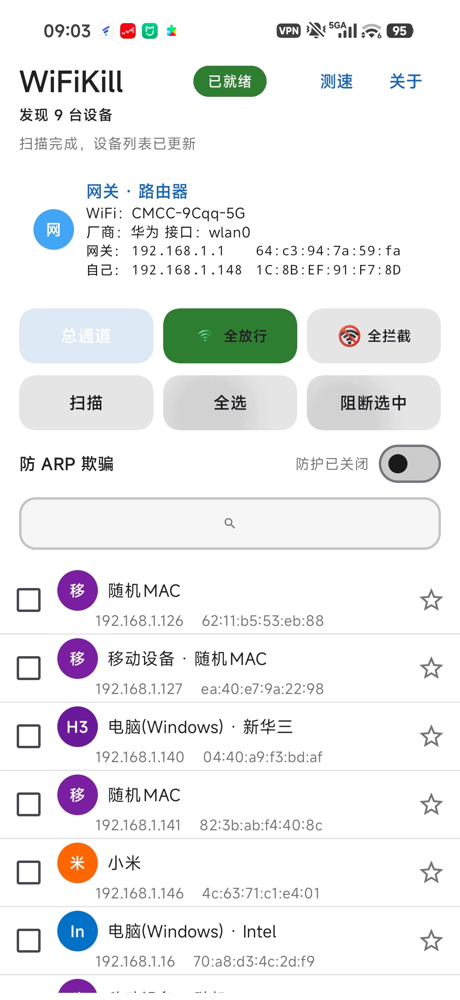

  <strong>🌐 Languages</strong> ·
  <a href="README.md">简体中文</a> ·
  <a href="README.en.md"><strong>English</strong></a>

---

# WiFiKill

  

Old-timers in the modding scene surely remember the legendary "one-tap network killer" — WiFiKill.

So many people's youth (and pranks) were spent "rampaging" across a LAN with it. Later the original developer stopped updating, the APK broke, crashed, and became incompatible — and the app slowly sank...

Until now — it's back!

I spent a lot of time rebuilding it with a modern tech stack, turning it from "installs but doesn't work" into "works great and keeps updating." The core is still the good old ARP disconnect, but the foundation is all new.

## ✨ Features

- 🔍 Auto-scan all devices on your current network
- ⛔ Block any single device / all devices to cut off their network
- ✅ Unblock everything, restore full network
- 📌 Pin frequently-used devices
- ⭐ Whitelist & device notes
- 🏷 Device type detection (vendor / mobile)
- 🛡 Defense mode against ARP attacks
- 📶 WiFi network speed test (latency / real-time bandwidth chart)
- 🌙 Dark mode + Chinese / English switching

## ⚠️ Important Notice

This tool is intended only for testing and learning on networks you own or are explicitly authorized to use. Don't mess with other people's networks — you alone are responsible for whatever happens. Have fun, but don't cross the line.

---

At 1 a.m., my roommate across the room was still "gaming," keyboard clacking like a telegraph, yelling "go go go" and "damn it."

After ten minutes, I opened WiFiKill and tapped his device — block.

Five seconds later: "What the... I'm disconnected? Where's my network???"

He muttered "let me reconnect" and went quiet.

Losing a game of League is no big deal; losing sleep really sucks. Tools exist to be used when needed. 😏
